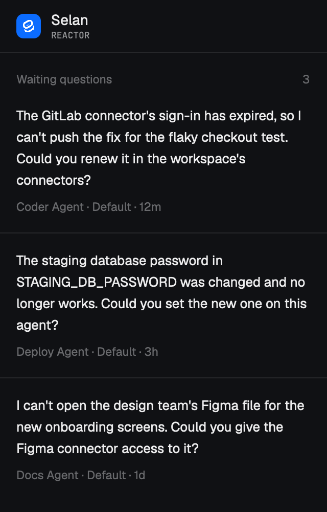

# Selan Reactor for Herdr

See and answer the questions your [Selan Reactor](https://selan.ai) agents are waiting on you for,
without leaving [Herdr](https://herdr.dev): a panel listing them newest first, the Dock badge with
how many, a toast for each new one, and a dialog to answer in place.



## Install

You need the Selan CLI 1.31 or later, signed in:

```sh
selan update
selan login
selan reactor questions   # should list your waiting questions
```

Then ask the agent in your Herdr window:

> add herdr.dev/mods/selan-ai/herdr-reactor

`add github.com/selan-ai/herdr-reactor` works too. To add it by hand, copy `mods/selan-reactor/` into
`~/.config/herdr-app/mods/` and run `herdr-app check ~/.config/herdr-app/mods/selan-reactor`.

## What it runs

The mod runs one program, `selan reactor …`, which holds your sign-in; the mod never sees a token
and fetches nothing itself. `RECIPE.md` describes the mod in full.

## License

MIT. The preview shows sample data.
