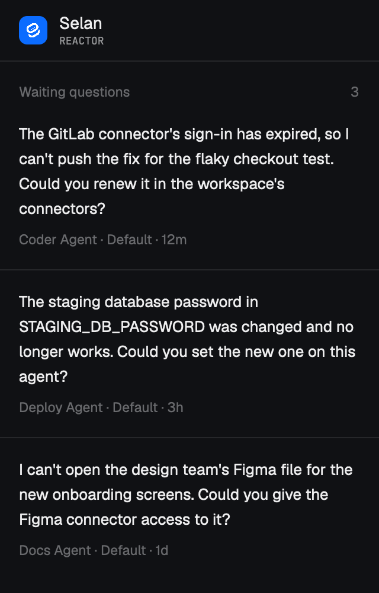

# Selan Reactor questions

A panel of the questions your Selan Reactor agents are waiting on you for, newest first, with the
Dock badge showing how many and a toast for each new one. Press a question to read it whole and
answer it in place; the agent picks up where it stopped.

## What you see

- **A panel**, docked on the right at 320 px (`mod.json`), on the `chrome` background.
- **Brand row**, 52 px tall, 16 px side inset, a 1 px `border` line under it: Reactor's mark (the
  blue Selan tile, `#0B6CFF`, white mark) at 24 px with 7 px corners, 10 px gap, then two lines 3 px
  apart: "Selan" at 14 px bold on a 15 px line, and "REACTOR" at 9 px semibold in the terminal font
  (`settings().font_family`), `muted`, on a 9 px line.
- **Label row**, 16 px below the brand line: "Waiting questions" at 11.5 px medium, `dim`, with the
  count at the right edge in the same style while any wait.
- **Questions**, each a row with 16 px above and below and 16 px side inset: the question in 13 px
  `foreground`, wrapped, then 6 px below it one `dim` 11.5 px line `agent · workspace · age`
  (`now`, `5m`, `3h`, `2d`). A 1 px `border` line runs edge to edge between rows, none above the
  first or below the last. Hover fills the row with `hover`.
- **Empty, loading and failure** are one `dim` 12 px line in the same inset: "No questions waiting.",
  "Reading Reactor…", "Could not read Reactor: <reason>".
- **The dialog** (560 × 520, `popover`, 20 px padding, 16 px between parts): the mark at 28 px with
  8 px corners beside the agent's name (15 px semibold on a 17 px line) over `workspace · age`
  (11.5 px `dim` on a 13 px line, 3 px apart), "Esc" at the right in 11 px `dim`; the question in
  13 px medium; the agent's details in `muted`, scrolling; a 4-row text area "Your answer" with
  9 px corners, `input` border, `background` fill; Cancel (`raised`) and Send (`solid`), 32 px
  tall, 8 px corners, right-aligned 8 px apart.
- **The Dock badge** is the number waiting, cleared at none.
- **A toast** for each new question: the mark as its icon, "<agent> asks" and the question; several
  at once are one toast, "<n> new Reactor questions" with the agents' names.

## How it behaves

- Reads the questions when it starts and every 60 s after. A question already announced is not
  announced again, across restarts (`localStorage`).
- Pressing a question opens the dialog; pressing a toast opens the newest question.
- Send runs the answer: the button reads "Sending…" and is dimmed until Reactor answers, which can
  take minutes because the agent's run starts again. On success the dialog closes, a toast says
  "Answered <agent>", and the panel reads again. On failure "Not sent: <reason>" shows in `blocked`
  under the text area and the question stays open. An empty answer is allowed: the agent is told
  "done".
- Esc or Cancel closes the dialog without sending.
- **Folding**, only when a layout gives the panel props `{ "collapse": "<block id>" }`: while no
  question waits, that block shrinks to a 52 px strip with the mark alone, where the brand row has
  it (hover: "No questions waiting"). A new question, or a read that fails, opens it again to the
  width it had (320 px at first). It folds and opens only when that changes, so a width the person
  drags stays until the next change. Without the prop the panel never folds.

## Built from

- One mod, `mods/selan-reactor/`: `main.js`, `mod.json` (`place: right`, `size: 320`) and
  `reactor.svg`. The same mod draws the dialog when opened with props `{ question }`.
- `herdr` functions: `exec`, `theme`, `settings`, `props`, `run`, `layout`, `openOverlay`, `closeOverlay`,
  `notify`, `playSound("blocked")`, `setBadge`, `checking`, `nextCommand`. Folding runs
  `layout.resize` on the named block and draws again from the root's `on_size_change`, since the
  new width lands after the render that asked for it. Commands it answers:
  `selan-reactor.refresh` and `selan-reactor.open`.
- **Runs one program: the Selan CLI**, which holds the person's sign-in, so the mod never handles a
  token. `selan reactor questions --json` prints
  `{"questions":[{"id","agent","workspace","question","details","askedAt"}]}`;
  `selan reactor answer <id> <text> --json` prints `{"runId"}`. Either prints `{"error"}` on
  failure. The CLI talks to Selan's gateway over the network; the mod itself fetches nothing.

## Watch out

- Needs the Selan CLI 1.31 or later on `PATH`, signed in (`selan login`). An older one answers
  "unknown command", which is not JSON; the panel then says to run `selan update`.
- `exec` runs in the person's environment: a CLI missing from that `PATH` shows as "Could not read
  Reactor: selan did not run".
- The pane frame title is Herdr's own header and reads the mod's folder name.
- Line heights are set explicitly on the two-line titles; GPUI's default line height leaves a gap
  that looks loose between a name and its caption.

## Done when

- `herdr-app check mods/selan-reactor` passes.
- With questions waiting, the panel lists them newest first and the Dock shows their count.
- A new question raises one toast with the mark; pressing it opens that question.
- Sending an answer closes the dialog, the toast says "Answered <agent>", and the question is gone
  from the panel within one read.
